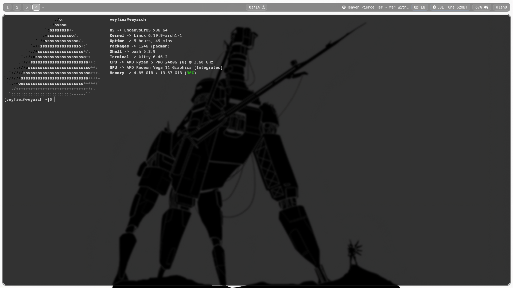

# dotfiles — Hyprland rice

Мои конфиги для Arch Linux / EndeavourOS: Hyprland, Waybar, Kitty и Fastfetch.
Минималистичный тёмный стиль: полупрозрачный бар, скруглённые границы, без лишнего.



## Состав

| Файл | Что это |
|---|---|
| `.config/hypr/hyprland.conf` | Основной конфиг Hyprland: монитор, ввод, анимации, бинды, правила окон |
| `.config/waybar/config` | Модули бара: рабочие столы, окно, часы, Spotify, трей, язык, Bluetooth, звук, сеть, батарея |
| `.config/waybar/style.css` | Оформление бара |
| `.config/kitty/kitty.conf` | Терминал: прозрачность 0.8, Ctrl+C/V для копирования/вставки |
| `.config/fastfetch/monochrome.jsonc` | Монохромный вывод Fastfetch с логотипом EndeavourOS |

## Установка

```bash
# 1. Пакеты (Arch)
sudo pacman -S hyprland waybar kitty rofi hyprlock grim slurp wl-clipboard \
  swww playerctl pavucontrol blueman flameshot fastfetch dolphin polkit-kde-agent

# 2. Конфиги
git clone https://github.com/Veyfier/dotfiles.git ~/dotfiles
cp -r ~/dotfiles/.config/* ~/.config/

# 3. Обои (путь можно поменять в hyprland.conf)
cp /path/to/your/wallpaper.jpg ~/bg.jpg

# 4. Перезапустить Hyprland
```

Для шрифтов Waybar нужен **JetBrainsMono Nerd Font**:

```bash
sudo pacman -S ttf-jetbrains-mono-nerd
```

## Горячие клавиши

| Комбинация | Действие |
|---|---|
| `Super + Q` | Kitty |
| `Super + E` | Dolphin |
| `Super + R` | Rofi (запуск приложений) |
| `Super + L` | Блокировка (hyprlock) |
| `Super + M` | Выход из Hyprland |
| `Super + V` | Плавающее окно |
| `Super + F` | Полный экран |
| `Super + C` | Закрыть активное окно |
| `Super + Shift + R` | Перезапустить Waybar |
| `Super + 1..5` | Перейти на рабочий стол |
| `Super + Shift + 1..5` | Переместить окно на рабочий стол |
| `Ctrl + ;` | Скриншот области в буфер |
| `Ctrl + Alt + ;` | Скриншот всего экрана в буфер |
| `Super + Shift + S` | Скриншот области в файл |
| `Ctrl + Space` | Переключение раскладки (us/ru) |

> Нужен Alt+Shift вместо Ctrl+Space? В `hyprland.conf` замените
> `grp:ctrl_space_toggle` на `grp:alt_shift_toggle`.

## Что было изменено при публикации

Исходный бэкап содержал много служебных файлов. В репозиторий они не попали:

- удалены 18 стандартных файлов `kate/externaltools/*.ini` — они поставляются
  вместе с Kate и не являются частью конфига;
- удалён стандартный `.desktop`-файл Flameshot;
- удалён `hyprpaper.conf` — он не использовался (обоями управляет `swww`);
- два конфликтующих блока `input {}` объединены в один (раньше второй блок
  молча перекрывал первый);
- убран бинд `Super + Escape → systemctl reboot`;
- `Super + C` упрощён до `killactive`;
- захардкоженный путь `/home/veyfier/bg.jpg` заменён на `~/bg.jpg`.

## Лицензия

[MIT](./LICENSE)
